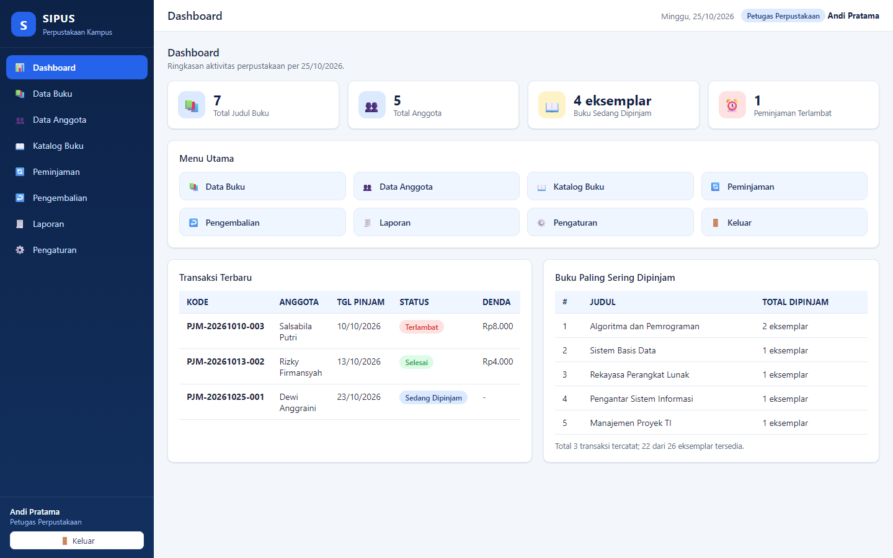
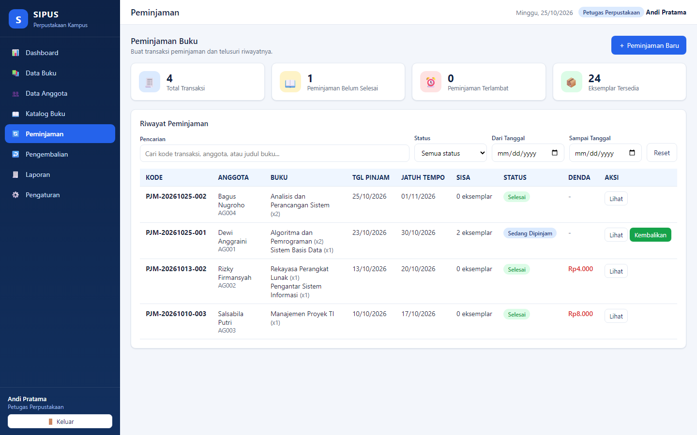
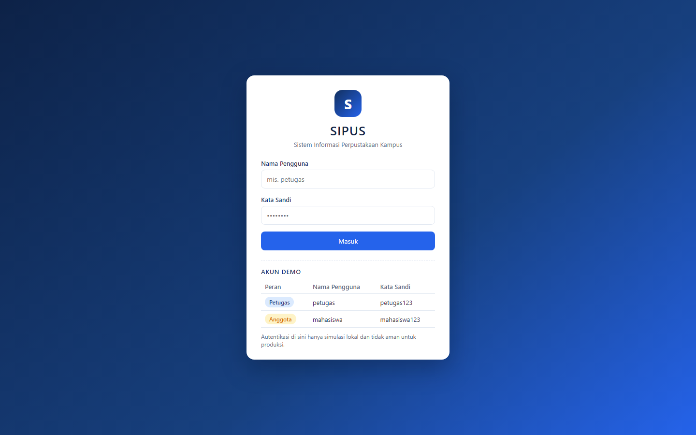
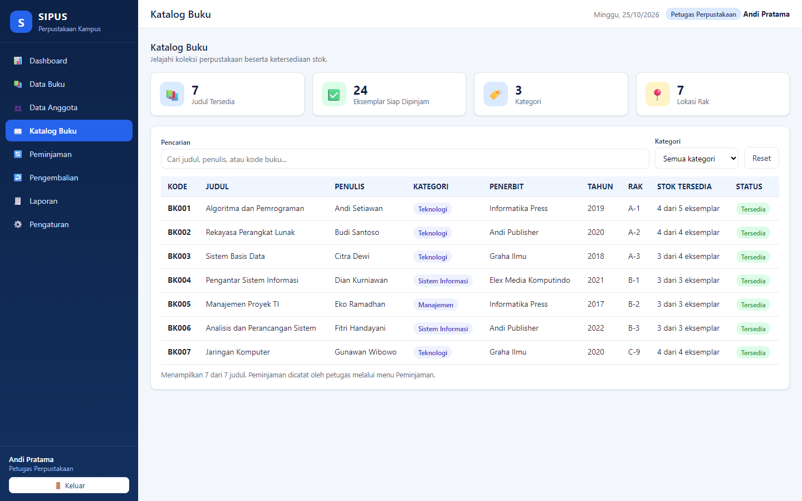
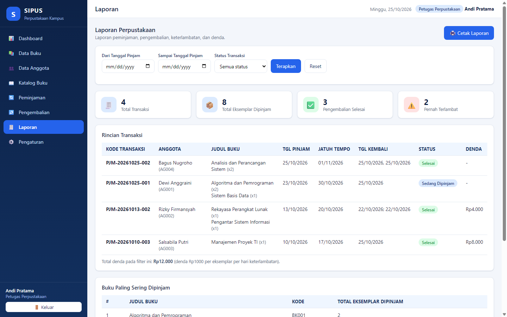

# SIPUS — Sistem Informasi Peminjaman Buku Perpustakaan Kampus

**SIPUS (Sistem Informasi Perpustakaan)** adalah aplikasi web untuk mengelola koleksi buku, data anggota, peminjaman, pengembalian, dan laporan perpustakaan kampus. Dibangun murni dengan **HTML, CSS, dan JavaScript** — tanpa framework, tanpa backend, dan tanpa build step. Cukup buka `index.html` di browser, aplikasi langsung berjalan.

## Tujuan

Menyediakan simulasi sistem informasi perpustakaan yang fungsional untuk kebutuhan pembelajaran mata kuliah Sistem Informasi: mulai dari pencatatan koleksi dan anggota, transaksi peminjaman/pengembalian beserta aturan stok dan denda, hingga pelaporan dan ekspor/impor data.

## Fitur

- **Dashboard** — ringkasan total judul buku, total anggota, buku sedang dipinjam, peminjaman terlambat, daftar transaksi terbaru, buku paling sering dipinjam, dan pintasan menu. Statistik diperbarui otomatis saat data berubah.
- **Manajemen buku** — tambah, ubah, hapus, detail; pencarian (judul/penulis/kode) dan filter kategori; validasi kode buku ganda dan stok negatif; pembatasan hapus bila buku masih dipinjam; pembedaan jumlah judul, total eksemplar, dan stok tersedia.
- **Manajemen anggota** — tambah, ubah, hapus, detail; pencarian (nama/NIM/ID); validasi ID & NIM ganda; anggota dengan pinjaman aktif tidak dapat dihapus.
- **Peminjaman** — satu transaksi bisa memuat beberapa judul; tanggal pinjam default hari ini, jatuh tempo +7 hari kalender; batas maksimal 3 eksemplar belum dikembalikan per anggota; stok tersedia berkurang otomatis; penolakan saat stok tidak tersedia atau batas tercapai; riwayat dapat dicari/difilter.
- **Pengembalian** — pengembalian seluruh atau sebagian eksemplar per transaksi; tanggal pengembalian aktual dicatat per eksemplar; stok bertambah tepat satu kali per eksemplar; transaksi **Selesai** saat semua eksemplar kembali; status **Terlambat** otomatis; denda **Rp1.000/eksemplar/hari** kalender (termasuk denda sementara untuk yang belum kembali); pencegahan pengembalian ganda.
- **Katalog buku** — judul, penulis, kategori, lokasi rak, ketersediaan stok, label *Tersedia*/*Stok Habis*, pencarian dan filter kategori.
- **Laporan** — laporan peminjaman, pengembalian, keterlambatan, dan denda; filter rentang tanggal dan status; kolom kode transaksi, anggota, judul buku, tanggal pinjam, jatuh tempo, tanggal kembali, dan denda; buku paling sering dipinjam; tombol **Cetak Laporan** memakai fitur print browser (CSS cetak khusus disediakan).
- **Pengguna & hak akses** — halaman login untuk petugas dan anggota; petugas mengelola seluruh data, anggota hanya melihat katalog dan riwayat peminjamannya sendiri; tombol keluar tersedia.
- **Penyimpanan** — data disimpan di `localStorage` (bertahan setelah reload), ekspor ke berkas JSON, impor dengan **validasi struktur & relasi terlebih dahulu** (data lama baru diganti setelah valid dan dikonfirmasi), tombol **Muat Data Contoh** dengan konfirmasi, serta notifikasi sukses/gagal.

## Aturan Peminjaman

| Aturan | Nilai |
| --- | --- |
| Masa peminjaman | 7 hari kalender setelah tanggal pinjam |
| Batas per anggota | 3 eksemplar yang belum dikembalikan |
| Denda keterlambatan | Rp1.000 per eksemplar per hari kalender |
| Format tanggal | dd/mm/yyyy (tanggal lokal perangkat) |

## Teknologi

- HTML5, CSS3, JavaScript ES6+ (tanpa framework/pustaka pihak ketiga)
- Penyimpanan: `localStorage` + `sessionStorage` (sesi)
- Pemuatan skrip dengan pola `<script>` berurutan biasa agar kompatibel dibuka langsung via `file://`
- Skrip uji: Node.js (tanpa dependensi) memakai konteks VM dan Chrome DevTools Protocol

## Struktur Folder

```
sipus/
├── index.html          # Struktur utama aplikasi (login + kerangka halaman)
├── css/
│   └── style.css       # Seluruh gaya antarmuka (layout, komponen, responsif, cetak)
├── js/
│   ├── app.js          # Inisialisasi, navigasi, modal, notifikasi, pengaturan
│   ├── storage.js      # localStorage, util tanggal, ekspor/impor, data contoh
│   ├── auth.js         # Simulasi login, hash kata sandi, hak akses
│   ├── books.js        # Manajemen buku + katalog
│   ├── members.js      # Manajemen anggota
│   ├── transactions.js # Peminjaman, pengembalian, stok, keterlambatan, denda
│   └── reports.js      # Dashboard dan laporan (+ cetak)
├── screenshots/        # Screenshot aktual aplikasi yang berjalan
├── tests/
│   ├── logic.test.mjs      # Pengujian logika (Node, 72 asersi)
│   └── browser.test.mjs    # Pengujian UI Chrome headless (69 asersi)
├── README.md
└── .gitignore
```

## Cara Menjalankan

1. Salin/kloning folder proyek ini.
2. Buka **`index.html`** langsung di browser (Chrome/Edge/Firefox) — cukup dobel-klik file tersebut.
3. Tidak perlu server lokal maupun perintah build.
4. (Opsional) Muat data contoh melalui menu **Pengaturan → ✨ Muat Data Contoh**.

## Akun Demo

| Peran | Nama Pengguna | Kata Sandi | Keterangan |
| --- | --- | --- | --- |
| Petugas | `petugas` | `petugas123` | Akses penuh: buku, anggota, peminjaman, pengembalian, laporan, pengaturan |
| Anggota | `mahasiswa` | `mahasiswa123` | Terhubung ke anggota `AG001` — hanya katalog & riwayat peminjaman sendiri |

Akun demo juga ditampilkan pada halaman login. **Catatan keamanan:** autentikasi berbasis browser ini hanya simulasi. Kata sandi disimpan dalam bentuk hash (SHA-256 bila tersedia), namun penyimpanan lokal di sisi browser **tidak memberikan keamanan yang memadai** dan **tidak boleh dipakai untuk produksi**.

## Screenshot Antarmuka

Screenshot berikut diambil langsung dari aplikasi yang berjalan (Chrome, 1440×900) — bukan mockup.

### Dashboard


### Halaman Peminjaman


### Halaman Login


### Katalog Buku


### Laporan


## Pengujian

Dua skrip uji tanpa dependensi tambahan:

```bash
# 1) Pengujian logika (CRUD, stok, denda, impor, persistensi, autentikasi) — 72 asersi
node tests/logic.test.mjs

# 2) Pengujian UI di Chrome headless (login, formulir, pinjam/kembali, impor file,
#    hak akses, responsif, reload) — 69 asersi + menyiapkan folder screenshots/
node tests/browser.test.mjs
```

Kedua skrip keluar dengan kode `0` bila lulus. Pengujian UI juga memeriksa tidak ada error console. Path Chrome dapat dioverride lewat variabel lingkungan `SIPUS_CHROME`.

Cakupan pengujian sesuai daftar pemeriksaan: tambah/ubah/cari/hapus buku & anggota, peminjaman (stok berkurang), penolakan (stok habis / batas anggota), pengembalian (stok bertambah tepat satu kali), perhitungan keterlambatan & denda, kecocokan dashboard & laporan dengan data transaksi, persistensi setelah reload, ekspor/impor JSON (termasuk penolakan berkas tidak valid), navigasi, hak akses demo, tampilan responsif, dan kebersihan console.

## Batasan & Pengakuan Keterbatasan

- **Tanpa backend** — seluruh data tersimpan di `localStorage` browser perangkat dan browser tersebut saja; tidak ada sinkronisasi antar-perangkat/pengguna.
- **Autentikasi hanya simulasi** — tidak aman untuk produksi; hash lokal mudah dibaca oleh pemilik perangkat. Jangan memakai data nyata.
- **Ekspor/impor manual** — belum ada backup otomatis; gunakan tombol ekspor secara berkala.
- **Denda belum dibayar** — sistem menghitung dan menampilkan denda, tetapi belum mencatat pembayaran.
- Pengujian otomatis berfokus pada logika dan alur UI inti; uji visual lintas browser (mis. Firefox/Safari) belum dilakukan di lingkungan ini.

## Pengembangan Selanjutnya (opsional)

- Pencatatan pembayaran denda dan kartu anggota.
- Pencarian penuh-teks serta pengurutan kolom tabel.
- Ekspor laporan ke CSV/PDF.
- Mode gelap dan penyimpanan preferensi tampilan.

---

Dibuat untuk tugas perkuliahan Sistem Informasi. Seluruh data contoh bersifat fiktif.
